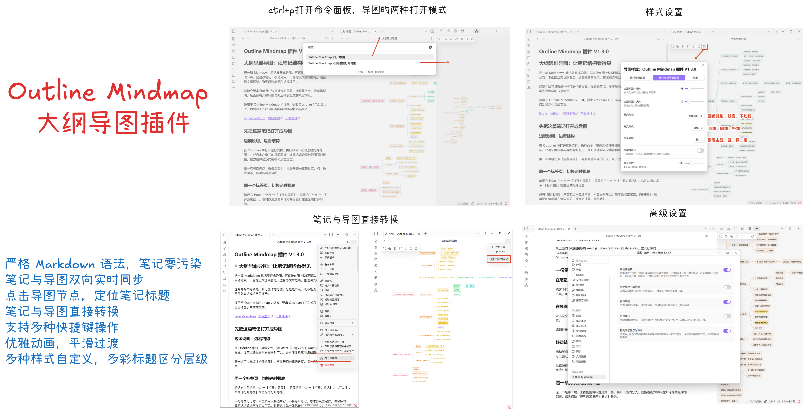

# Outline Mindmap

**Your Markdown notes, effortlessly alive as a mind map.**

[中文说明](readme-zh.md) · [Download](https://github.com/cimuyang/outline-mindmap/releases/latest) · [Overview](demo1.png) · [Changelog](#recent-updates) · Obsidian 1.7.2+

 

 

No proprietary syntax. No hidden markers cluttering your files.  
**Edit the map, edit the note**—rearrange a branch and its paragraphs travel with it. Open a **body card** right beside any heading to write in flow without ever losing sight of the whole. Clean, understated, and instant—your notes stay pure Markdown from start to finish.

---

## Highlights

- **Pure Markdown, zero pollution**  
  No YAML injection, no custom properties, no hidden comments. Every style, viewport, and view preference lives cleanly inside the plugin’s own data folder—your `.md` files remain untouched and portable anywhere.

- **Real-time two-way sync with surgical writes**  
  Your note and mind map share a single source of truth. Rename a heading and the node updates; drag a branch and every subheading and paragraph moves with it. Each edit patches only the affected lines, leaving the rest byte-for-byte intact with single-step undo.

- **Body cards—write deeply without leaving the big picture**  
  Open any section’s Markdown body right beside its node, with live preview toggle, auto-save on pause, and conflict-safe local draft recovery. **Keep multiple cards open** to compare passages side by side, or **dock a panel** that follows whichever node you select.

- **Click to locate, swap views in place**  
  Click any node in the sidebar to scroll and highlight its heading in the visible note. Switch a tab directly between **Open as mindmap** and **Open as note** without spawning extra tabs, with optional per-note memory.

- **Fluid keyboard control & graceful motion**  
  Add siblings with `Enter`, children with `Tab`, navigate naturally with direction-aware arrow keys, move branches with assignable hotkeys, and copy full branches across notes with automatic internal-link rebasing—all accompanied by restrained, synchronized layout motion.

- **Tailored appearance, live preview & crisp export**  
  3 layout directions, 4 node shapes (including frameless **Text only**), 3 connector styles, level-based and custom palettes, plus per-level **H1–H6** heading sizes. Apply per note or globally with live preview, and export to **PNG, SVG, or PDF**.

- **Deep lists & rich inline Markdown**  
  Build maps from `#`–`######` headings and optionally enable bulleted or numbered list nodes independently. Node labels natively render bold, italic, strikethrough, inline code, default and six-color highlights, readable link labels, and `$...$` inline math.

- **Built for 1,000-node outlines, desktop & mobile**  
  Engineered with offscreen text measurement, recycled node DOM, and a single merged SVG connector path. Full touch support with two-finger pan and pinch-to-zoom, plus automatic read-only locking when a note is in Reading view.

View interface & feature overview screenshot

 

*Note: The overview image and demo above were captured on an earlier release; newer additions such as Body cards, Text-only nodes, per-level H1–H6 sizing, export, and branch movement commands are documented below.*

---

## Quick Start

Once the plugin is enabled, get into flow in under a minute:

1. **Open a map**  
   With any note containing headings open, click the mind map icon in the left ribbon—or press `Ctrl/⌘ + P` and run **Open mindmap in sidebar**—to view note and map side by side. Run **Open mindmap** to open a full canvas tab in the main workspace.

2. **Locate and rearrange**  
   Click any sidebar node to scroll and highlight its heading in the note. Drag a node onto another’s top or bottom edge to place it before or after, onto the center to make it a child, or onto empty space to create a new root—its body paragraphs follow automatically.

3. **Outline without touching the mouse**  
   Select a node and press `Enter` for a sibling, `Tab` for a child, `F2` (or double-click) to rename, `Shift + Enter` to finish editing, or `Esc` to cancel cleanly. Press `Ctrl/⌘ + Z` anytime for single-step undo.

4. **Write right inside Body cards**  
   Enable **Body cards → Node body** in plugin settings. Click the document icon beside any node to read or write that section in Markdown. Use the card’s **⋯** menu to **Keep card open** for side-by-side comparison, or **Dock panel** for a fixed writing surface.

5. **Swap views & customize**  
   Choose **Open as mindmap** from a note’s **⋯** menu to turn the current tab into a map, and **Open as note** to switch back. Use the top-left toolbar to fit, zoom, filter by `H1–H6`, toggle read-only lock, or open the palette modal to style and export.

---

## When It Shines

- **Long-form writing & research drafts**  
  Keep your note beside the map—or work in a map tab with a docked body panel. Sketch the argument visually, drag sections until the narrative flows, and let every paragraph follow cleanly without manual cut-and-paste.

- **Comparing passages while revising**  
  Open two or three body cards on the canvas and mark them **Keep card open**. Cross-check claims, transitions, and phrasing right next to your outline instead of scrolling back and forth through thousands of words.

- **Book notes & structured study**  
  Enable list nodes and **Color by level** to see an entire book or course at a glance—complete with highlights and `$...$` formulas. Click any concept to jump straight to the exact excerpt in your note.

- **Reviews, walkthroughs & sharing**  
  Emphasize hierarchy with per-level **H1–H6** heading sizes and clean **Text only** or **Elbow** layouts. Collapse down to H2 during a walkthrough, then export a high-resolution transparent PNG, scalable SVG, or fitted PDF in one click.

- **Frictionless brainstorming & cross-note reuse**  
  Double-click empty canvas space on a blank note and branch rapidly with `Enter` and `Tab`. Copy or cut whole branches (`Ctrl/⌘ + C/V`) into another note—internal Obsidian links rebase automatically, and the result is already standard Markdown.

---

## Feature Guide

> Below, `Mod` means `Ctrl` on Windows/Linux and `⌘` on macOS.

### Views, Following & Search

| Goal | How |
| --- | --- |
| **Read & edit side by side** | Click the left ribbon icon or run **Open mindmap in sidebar**. Clicking a node scrolls and highlights the matching heading in any visible note without stealing keyboard focus. |
| **Main-workspace canvas** | Run **Open mindmap** from the command palette. Configure main-area behavior (**Follow current note**, **Keep current note**, or **One map per note**) independently from the sidebar under **Opening and following**. |
| **Swap note ⇄ map in place** | Choose **Open as mindmap** from the note’s **⋯** menu, file explorer context menu, or tab menu; choose **Open as note** in the map’s **⋯** menu to return (restoring Reading/Editing view). Per-note memory is enabled by default. |
| **Heading range & toolbar** | Use the toolbar to fit, zoom, and expand/collapse. The dropdown beside expand/collapse (or command palette) filters the map to `H1–H6` and remembers your range per note. |
| **Read-only lock** | Click the toolbar lock to prevent accidental edits (remembered per note). A note in Reading view automatically locks map edits while preserving pan, zoom, folding, and click-to-jump. |
| **Obsidian search integration** | Opening a remembered mindmap note from Obsidian search expands and highlights matching branches. Body-text matches show an excerpt bar with a temporary **View in note** shortcut. |

### Canvas, Keyboard & Mouse Editing

| Action | How |
| --- | --- |
| **Pan & zoom** | Drag empty canvas or scroll to pan; `Mod + Wheel` zooms at the cursor. On touch screens, use two fingers to pan and pinch-zoom. Zoom and viewport position are remembered per note. |
| **Arrow navigation** | `↑` / `↓` move between siblings; `←` / `→` adapt to each branch’s growth direction to step into children or collapse/return to the parent. |
| **Create nodes** | `Enter` adds a sibling; `Tab` adds a child; double-click empty canvas space to start a new root. While typing a title, `Enter` / `Tab` commits and immediately starts the next sibling/child; `Shift + Enter` commits and stops. |
| **Rename & cancel** | Double-click a node or press `F2` to edit its raw Markdown title. Press `Esc` during renaming or dragging to cancel without writing a single byte. |
| **Drag to reorganize** | Drop on a node’s top/bottom edge to insert before/after, center to nest as a child, or empty space to make a root. Crossing level 6 converts seamlessly between headings and lists while moving body text along. |
| **Keyboard branch movement** | Open **Settings → Interaction → Branch movement hotkeys → Configure** to bind **Move branch · Up / Down / Promote / Demote** to your preferred keys. |
| **Multi-select, clipboard & menu** | `Mod + Click` selects multiple nodes. `Mod + C` / `Mod + X` copies or cuts complete Markdown branches (including body and folded descendants); `Mod + V` pastes as child, `Mod + Shift + V` as sibling (internal links rebase automatically across notes). Right-click a node for Body, Copy/Cut/Paste, Edit title, Copy title, Add ordered/unordered list child, and Delete. |
| **Delete & atomic undo** | `Delete` / `Backspace` removes selected branch(es) and body text. `Mod + Z` undoes and `Mod + Shift + Z` (or `Mod + Y`) redoes—even inside standalone map-only tabs. |

### Body Cards

- **Enable & open**: Turn on **Body cards → Node body** in settings. Nodes with existing body text show a document icon (others reveal it on hover or selection); click it, right-click → **Body**, or run **Show or edit body**.
- **Safe, effortless editing**: Switch between Markdown editing and rendered reading preview from the card header. Changes auto-save after pausing or on blur, or save immediately with `Mod + S` (`Esc` flushes and closes). If the source file changes externally and conflicts, the card alerts you and preserves your draft locally.
- **Floating & docked layouts**: Drag a floating card by its header and resize from any edge or corner. From the card’s **⋯** menu, choose **Keep card open** to compare multiple sections at once, or **Dock panel** for a fixed writing area that follows your selected node (automatically docking to the bottom in narrow panes).

### Markdown Parsing & Inline Rendering

- **Structure**: Parses `#` through `######` headings by default (ignoring YAML frontmatter and `#` inside fenced code blocks). Enable **Show list items as nodes** (`-`, `*`, `+`) and **Show ordered lists as nodes** (`1.`, `1)`) independently under **Nodes and editing**, and choose your **Deep node format** for level 7 and deeper.
- **Inline syntax**: Renders **bold**, *italic*, ***bold italic***, ~~strikethrough~~, `` `inline code` ``, ``/``, readable labels for `[[wiki|alias]]` and `[text](url)` links, and `$...$` MathJax inline formulas.
- **Default & six-color highlights**: Supports standard `==highlight==` plus six theme-matched color highlights:
  `==🔴Red==` · `==🟠Orange==` · `==🟡Yellow==` · `==🟢Green==` · `==🔵Blue==` · `==🟣Purple==`

### Appearance & Export

- **Appearance** (Toolbar palette → **Appearance**)  
  Every control updates the canvas live without saving until you click **Apply**:
  - **Structure**: Layout direction (**Branches right**, **Branches left**, **Both sides**), node shape (**Rounded rectangle**, **Pill**, **Underline**, **Text only**), and connector style (**Straight**, **Curve**, **Elbow**).
  - **Color**: Schemes (**Follow theme**, **Blue**, **Green**, **Warm**), **Color by level**, and **Custom colors** (canvas background, connectors, and Levels 1–6).
  - **Typography & spacing**: Toggle **Size headings by level** and expand **Customize heading sizes** to fine-tune `H1–H6` (75%–200% with live pixel readout); adjust base font size and horizontal/vertical spacing under **Details**.
  - **Scope**: Apply to **This note**, **Global**, or revert with **Use global appearance**. Per-note styles migrate automatically on rename and clean up on delete.
- **Export** (Toolbar palette → **Export**)  
  Choose **Current branches** or **Expand all**, pick **Map background**, **White**, or **Transparent background**, fine-tune quality (**Standard** / **High**), padding (**Compact** / **Standard** / **Spacious**), and PDF page (**Fit map** / **A4 landscape** / **A4 portrait**) under **More options**, and export to **PNG, SVG, or PDF**.

All settings & diagnostic commands

 

| Section | Setting | Description & default |
| --- | --- | --- |
| **Body cards** | Node body | Off by default. Enables body icons and inline body cards on nodes. |
| **Opening and following** | Main-area map | Defaults to **Keep current note**; also supports **Follow current note** and **One map per note**. |
| **Opening and following** | Keep the sidebar map on one note | Defaults to **Follow current note**; switch to **Keep current note** to pin the sidebar map. |
| **Opening and following** | Remember how each note opens | On by default. Remembers notes switched via **Open as mindmap** in `data.json` only. |
| **Nodes and editing** | Strict line breaks | Off by default. Pads to 3 blank lines between adjacent headings when adding or moving nodes. |
| **Nodes and editing** | Show list items as nodes | Off by default. Includes `-`, `*`, and `+` bulleted list items in the map. |
| **Nodes and editing** | Show ordered lists as nodes | Off by default. Includes `1.`, `1)` numbered list items in the map. |
| **Nodes and editing** | Deep node format | Defaults to **Bulleted list** (or **Numbered list**) for level 7 and deeper. |
| **Interaction** | Branch movement hotkeys | Opens Obsidian’s Hotkeys filtered to the four branch movement commands. |
| **Interaction** | Click to jump | On by default. Clicking a node scrolls and highlights its heading in any visible note. |
| **Interaction** | Graceful animation | On by default. Animates nodes and connectors together; auto-disabled above 250 visible nodes or when system reduced motion is enabled. |

**Diagnostic commands** (via command palette): **Performance report** (measures layout, first render, and repaint timings) · **Follow report** (shows and copies the recent note-following trail for troubleshooting).

---

## Recent Updates

- **1.3.11** — Fixed default highlights so both default and all six named colors match the native theme; added per-level H1–H6 heading sizes with live preview.
- **1.3.10** — Added four assignable branch movement commands, **Text only** nodes, and six-color highlights; improved title wrapping while renaming.

 

[Release History](https://github.com/cimuyang/outline-mindmap/releases) · [MIT License](LICENSE)
