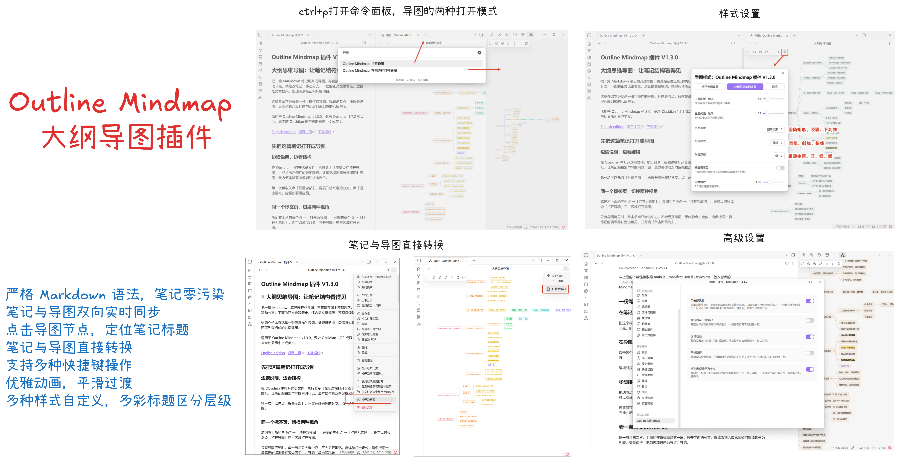

# Outline Mindmap · 大纲思维导图

**让 Markdown 笔记，自然生长为一张优雅的思维导图。**

[English](README.md) · [下载最新版](https://github.com/cimuyang/outline-mindmap/releases/latest) · [界面总览](demo1.png) · [更新说明](#更新说明) · Obsidian 1.7.2+

 

 

不引入任何专有语法，不向笔记写入多余标记。  
**改导图，就是改笔记**——重排分支时，子标题与段落正文同步流转；展开节点旁的**正文卡片**，俯瞰全局结构的同时从容落笔。简洁、克制、毫秒响应，你的笔记自始至终都是纯粹的标准 Markdown。

---

## 核心特色

- **纯净 Markdown，笔记零污染**  
  不写 YAML，不插属性，不留隐藏注释。所有样式、视口与打开偏好均独立存于插件目录，笔记移至任何编辑器都干干净净。

- **双向实时同步，微创写回**  
  原文与导图共享同一份数据：改笔记，导图即刻更新；拖分支，整节正文随之移动。每次写回仅精准替换受影响的行，范围外逐字节不变，一步操作对应一步撤销。

- **正文卡片，俯瞰全局的同时深写正文**  
  点击节点旁图标即可展开 Markdown 正文卡片，支持预览切换、停顿自动保存与冲突草稿保护。可同时**保留多张卡片对照**，也可**停靠侧栏**随选中节点自动切换。

- **点击即定位，笔记 ⇄ 导图无缝转换**  
  在侧边栏单击节点，原文瞬间滚动并高亮对应标题；在菜单一键「打开为导图 / 打开为笔记」，同一标签页就地切换视角，并自动记住每篇笔记的偏好。

- **全键盘流畅交互，柔和同步动画**  
  `Enter` 添同级、`Tab` 添子级、方向键自适应生长方向穿梭、快捷键四向调位、跨笔记复制分支并自动修正内部双链；每次展开、折叠与移动皆以克制顺滑的动画过渡。

- **多维外观定制，实时预览与高清导出**  
  3 种布局方向、4 种节点形状（含极简「无框文字」）、3 种连线、多彩层级与自定义配色，支持 H1–H6 独立字号调节；单篇与全局两级生效，一键导出 PNG / SVG / PDF。

- **深层列表与富文本原生呈现**  
  支持 H1–H6 与无序、有序列表独立展开；节点内原生渲染粗斜体、删除线、行内代码、默认与六色高亮、双链可读文字及 `$...$` 行内公式。

- **千级节点毫秒引擎，桌面移动皆从容**  
  单路径 SVG 连线与 DOM 复用架构，轻松驾驭长文大纲；完整适配移动端触屏双指平移与捏合缩放，阅读模式下自动防误触锁定。

查看界面与特性总览图

 

*注：总览图与上方动图录制于早期版本；正文卡片、无框文字、H1–H6 独立字号、导出与分支移位命令等新特性请以本文说明为准。*

---

## 快速上手

启用插件后，一分钟体验完整工作流：

1. **唤出导图**  
   打开一篇包含标题的笔记，点击左侧功能区导图图标，或按 `Ctrl/⌘ + P` 运行「**在侧边栏打开导图**」即可与原文左右并排；运行「**打开导图**」则会在主区域新标签页铺开大画布。

2. **单击定位，拖拽重组**  
   单击侧边栏任意节点，原文立即滚到对应标题并高亮。拖动节点至目标上缘或下缘插入前后，拖至中央成为子节点，拖至画布空白独立成根——章节正文会自动随节点移动。

3. **全键盘搭起大纲**  
   选中节点后直接用键盘：`Enter` 新建同级、`Tab` 新建子级、`F2`（或双击）修改标题、`Shift + Enter` 确认结束、`Esc` 无痕取消。需要回退时，按 `Ctrl/⌘ + Z` 一步撤销。

4. **打开正文卡片，在图上直接写作**  
   前往插件设置开启「**正文与卡片 → 启用节点正文**」。点击节点右侧文档图标即可编写这一节的正文；在卡片右上角 `⋯` 选择「**保留此卡片**」可多节对照，选择「**停靠侧栏**」可获得固定写作区。

5. **就地切换视角与定制外观**  
   在笔记右上角 `⋯` 点击「**打开为导图**」将当前标签页转为纯导图，导图菜单点击「**打开为笔记**」随时返回。点击画布左上角工具栏，即可一键适应画布、按 `H1–H6` 折叠层级、锁定只读，或点调色盘图标实时调校样式与导出图片。

---

## 使用场景

- **长文、论文与专栏大纲写作**  
  左侧正文、右侧导图，或纯导图搭配「停靠正文卡片」。先搭清逻辑骨架，再逐节落笔；发现章节顺序不顺时，在图上轻轻一拖，整段正文跟着搬家，告别万字长文里的反复剪切粘贴。

- **多节内容对照与精修改稿**  
  在导图画布上同时「保留」两三张正文卡片并排阅读，一边对照前后呼应与论据，一边即时修订，不必在长文档中来回翻滚。

- **读书笔记与知识体系梳理**  
  开启列表节点与「按层级着色」，整本书的脉络、重点高亮与数学公式一目了然；点击导图中的任意概念，原书摘录即刻定位高亮，复盘查阅极快。

- **方案汇报、复盘与视觉分享**  
  开启「按标题级别调整字号」突出主干，搭配「无框文字」或圆角折线呈现清爽版面；汇报时可一键只展示到 H2 聚焦宏观框架，需要分享时直接导出高清透明 PNG、矢量 SVG 或适配页面的 PDF。

- **灵感发散与跨笔记重组**  
  在空白笔记的导图画布上双击起头，全程用 `Enter` 与 `Tab` 顺畅发散；整理好的整条分支还可 `Ctrl/⌘ + C/V` 直接跨笔记粘贴，内部双链路径自动修正，沉淀即成标准 Markdown。

---

## 功能指南

> 下文中 `Mod` 在 Windows / Linux 上为 `Ctrl`，在 macOS 上为 `⌘`。

### 视图、跟随与搜索

| 场景 | 操作方式 |
| --- | --- |
| **左右对照编辑** | 点击左侧功能区图标，或运行命令「在侧边栏打开导图」。单击节点可将屏幕上已打开的笔记滚至对应标题并高亮，且不抢占键盘焦点。 |
| **主区域大画布** | 运行命令「打开导图」。可在插件设置「打开与跟随」中分别设定主区域（跟随 / 固定 / 每篇独立标签页）与侧边栏（跟随 / 固定）的跟随策略。 |
| **笔记 ⇄ 导图互转** | 在笔记右上角 `⋯`、文件列表右键或标签页右键选「打开为导图」；在导图 `⋯` 菜单选「打开为笔记」返回，并自动还原原先的阅读/编辑模式。默认按篇记住打开方式。 |
| **层级范围与工具栏** | 工具栏支持适应画布、缩放、一键展开/收起；折叠按钮旁的下拉菜单（或命令面板）可按篇限定只显示到 `H1–H6` 并自动记忆。 |
| **只读防误触锁定** | 点击工具栏锁图标锁定当前笔记（按篇记忆）；当原文处于阅读模式时导图自动强制锁定，仍可平移、缩放、折叠与点击定位。 |
| **全局搜索联动** | 通过 Obsidian 搜索打开已记住为导图的笔记时，自动展开并高亮命中分支；正文命中会在底部展示摘录，并提供「查看原文」临时跳转入口。 |

### 画布与编辑操作

| 操作 | 方法 |
| --- | --- |
| **平移与缩放** | 拖拽空白处或滚轮平移，`Mod + 滚轮` 以指针为中心缩放；触屏支持双指平移与捏合缩放。每篇笔记自动记忆缩放比例与视野位置。 |
| **方向键穿梭** | `↑` `↓` 同级切换，`→` / `←` 依节点实际生长方向进入子节点或收起返回父节点。 |
| **新建节点** | `Enter` 添加同级，`Tab` 添加子节点；双击画布空白处新建自由根节点。标题编辑中输入完按 `Enter` / `Tab` 可连续创建，`Shift + Enter` 确认结束。 |
| **编辑与取消** | 双击节点或按 `F2` 直接编辑原始 Markdown 标题；编辑或拖拽中按 `Esc` 立即取消，不写入任何内容。 |
| **拖拽重排** | 拖到节点上缘 / 下缘插至前后，拖到中央成为子节点，拖到空白处成为自由根。跨过第 6 层时自动在标题与列表间转换，正文一并跟随。 |
| **键盘四向移位** | 前往插件设置「交互 → 节点移动快捷键 → 配置」，即可为「同级上移」「同级下移」「提升一级」「降低一级」绑定顺手的按键。 |
| **多选、剪贴与右键** | `Mod + 左键` 多选节点；`Mod + C / X` 复制或剪切完整分支（含正文与折叠后代），`Mod + V` 粘贴为子节点，`Mod + Shift + V` 粘贴为同级（跨笔记粘贴自动修正内部双链）。右键节点还可打开正文、仅复制标题或指定新增有序/无序列表子节点。 |
| **删除与单步撤销** | `Delete` / `Backspace` 删除选中分支及正文；`Mod + Z` 撤销，`Mod + Shift + Z`（或 `Mod + Y`）重做。纯导图标签页同样支持完整撤销。 |

### 正文卡片

- **开启与唤出**：在设置中开启「正文与卡片 → 启用节点正文」。有正文的节点会常驻文档图标（其余节点在悬停或选中时显示）；点击图标、右键选「正文」或运行命令「查看或编辑正文」即可打开。
- **安心写作**：支持在 Markdown 编辑与渲染预览间一键切换；输入停顿或失焦时自动保存，也可按 `Mod + S` 立即保存、`Esc` 保存并关闭。若原文在别处被修改导致冲突，卡片会立即提醒并将未保存草稿留在本地。
- **灵活布局**：浮动卡片支持拖动标题栏移动、八向拖边角调尺寸；点右上角 `⋯` 选择「**保留此卡片**」可在画布上并排对照多节正文，选择「**停靠侧栏**」则固定为随选中节点自动切换的写作区（窄窗口下自动停靠于底部）。

### Markdown 语法与行内渲染

- **结构识别**：默认将 `#` 到 `######` 标题解析为导图（自动跳过 YAML frontmatter 与代码块中的 `#`）。在「节点与编辑」中可分别开启无序列表（`-`、`*`、`+`）与有序列表（`1.`、`1)`）节点，并指定第 7 层及以下的「深层节点格式」。
- **行内样式**：节点内原生渲染 **粗体**、*斜体*、***粗斜***、~~删除线~~、`` `行内代码` ``、``/``、`[[双链|别名]]` 与 `[链接](url)` 的可读文字，以及 `$...$` 行内 LaTeX 公式。
- **默认与六色高亮**：支持标准 `==高亮==`，并支持六种跟随原生主题的彩色高亮：
  `==🔴红==` · `==🟠橙==` · `==🟡黄==` · `==🟢绿==` · `==🔵蓝==` · `==🟣紫==`

### 外观定制与导出

- **外观面板**（工具栏调色盘 → **外观**）  
  支持实时预览且取消即无痕还原。可自由组合：
  - **版式**：布局方向（向右 / 向左 / 两侧均衡）、节点形状（圆角矩形 / 胶囊 / 下划线 / 无框文字）、连接线（直线 / 斜线 / 折线）。
  - **色彩**：预设方案（跟随主题 / 蓝 / 绿 / 暖）、「按层级着色」开关，以及「自定义配色」（画布背景、连接线、第 1–6 层独立取色）。
  - **排版**：开启「按标题级别调整字号」后可展开「自定义标题字号」逐级微调 `H1–H6`（75%–200%，实时显示像素值）；在「细节」中调节基础字号及横向、纵向间距。
  - **作用域**：支持应用到「仅此笔记」「所有笔记」或「改用通用样式」；单篇样式会随笔记重命名自动迁移、删除自动清理。
- **导出面板**（工具栏调色盘 → **导出**）  
  选择「按当前展开状态」或「展开全部」，搭配导图背景 / 白色 / 透明背景，并可在「更多选项」中设置画质（标准 / 高清）、留白（紧凑 / 标准 / 宽松）与 PDF 页面（随导图尺寸 / A4 横向 / A4 纵向），一键导出 **PNG / SVG / PDF**。

完整设置项一览与诊断命令

 

| 分组 | 设置项 | 说明与默认值 |
| --- | --- | --- |
| **正文与卡片** | 启用节点正文 | 默认关闭。开启后可在节点旁打开正文卡片。 |
| **打开与跟随** | 标签页中的导图 | 默认「固定当前笔记」，可选「跟随当前笔记」或「每篇笔记独立导图」。 |
| **打开与跟随** | 侧边栏中的导图 | 默认「跟随当前笔记」，可切换为「固定当前笔记」。 |
| **打开与跟随** | 记住每篇笔记的打开方式 | 默认开启。记住通过「打开为导图」转换过的笔记，记录仅存于 `data.json`。 |
| **节点与编辑** | 标题间留空行 | 默认关闭。开启后新增或移动相邻标题时自动保持 3 个空行。 |
| **节点与编辑** | 显示无序列表节点 | 默认关闭。开启后将 `-`、`*`、`+` 列表项解析为节点。 |
| **节点与编辑** | 显示有序列表节点 | 默认关闭。开启后将 `1.`、`1)` 等编号列表项解析为节点。 |
| **节点与编辑** | 深层节点格式 | 默认「无序列表」，可选「有序列表」，用于第 7 层及以下的新增或移动节点。 |
| **交互** | 节点移动快捷键 | 一键跳转至 Obsidian 快捷键页配置四向分支移位命令。 |
| **交互** | 单击即跳转 | 默认开启。单击节点滚动已可见的原文并高亮。 |
| **交互** | 优雅动画 | 默认开启。节点与连线同步平滑过渡；超过 250 个可见节点或系统开启减少动态效果时自动静默关闭。 |

**内置自检命令**（命令面板可用）：`性能自检`（测量当前导图的布局、首次渲染与重绘耗时）· `跟随自检`（输出同步留痕并自动复制，便于排查跟随行为）。

---

## 更新说明

- **1.3.11** — 修复默认高亮，默认高亮与六种指定颜色均跟随原生主题；新增 H1–H6 独立字号微调与实时预览。
- **1.3.10** — 新增四个可自定义快捷键的分支移动命令；新增「无框文字」节点样式与六色高亮；优化重命名时的标题折行体验。

 

[查看全部历史版本](https://github.com/cimuyang/outline-mindmap/releases) · [MIT 许可证](LICENSE)
