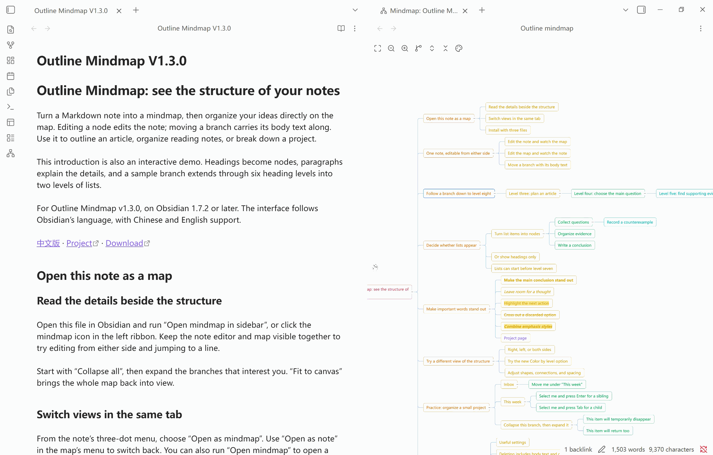

# 大纲思维导图 · Outline Mindmap

[English](README.md) · [下载安装文件](https://github.com/cimuyang/outline-mindmap/releases/latest) · [查看截图](demo1.png)

把一篇 Obsidian 笔记的标题变成可编辑的思维导图。写长文时，可以先在图上调换章节，再打开节点旁的正文卡片继续写。标题、段落和修改都保存在原来的 Markdown 笔记里。

动图录制于较早版本，下文使用 1.3.11 的菜单名称。

## 特色

- **一篇笔记，两种编辑方式。** 在笔记里改标题，导图随之更新；在图上移动一个分支，章节正文和子标题一起移动。笔记沿用普通 Markdown，无需添加属性或隐藏标记。
- **从标题直接写到正文。** 在节点旁打开卡片，边看全图边写这一节。可以同时保留几张卡片对照，也可以把当前正文停靠在一侧，随选中节点切换。
- **从全局定位到一句原文。** 在侧边栏浏览导图，点击节点即可定位到已打开的笔记。打开 Obsidian 搜索结果时，导图可以展开命中的分支，正文匹配也有返回原文的入口。
- **每篇笔记都有自己的读法。** 长文可以只展开两级标题、用字号突出章节；资料笔记可以展开列表、按层级着色。同一套外观既可应用到单篇，也可设为全局默认。

## 快速开始

1. **安装。** 适用于 Obsidian 1.7.2 及以上版本。从 [GitHub Releases](https://github.com/cimuyang/outline-mindmap/releases/latest) 下载 `main.js`、`manifest.json` 和 `styles.css`，放入仓库的 `.obsidian/plugins/outline-mindmap/`，然后在「设置 → 第三方插件」启用 **Outline Mindmap**。
2. **打开。** 打开一篇有标题的笔记，点击左侧功能区的导图图标。笔记留在原处，导图出现在右侧。
3. **试一次双向编辑。** 在笔记的编辑模式下，双击图中一个节点，改名后按 `Shift+Enter`。原文标题会随之更新。再在原文修改这个标题，观察导图同步变化。

## 使用指南

### 打开、跟随与定位

| 想做什么 | 在哪里操作 |
| --- | --- |
| 边看原文边看图 | 点击功能区的导图图标；单击节点可将可见的笔记滚到对应位置。 |
| 在主区域打开导图 | 命令面板 →「打开导图」。在插件设置的「打开与跟随」中选择跟随当前笔记、固定一篇或每篇笔记独立打开。侧边栏可单独设置。 |
| 将当前笔记标签页切成导图 | 在笔记的 ⋯ 菜单选「打开为导图」。在导图标签页菜单选「打开为笔记」即可返回。可按笔记记住打开方式。 |
| 浏览大图 | 用工具栏适应画布、缩放或展开／收起。展开按钮旁的菜单可选 H1–H6 显示范围；触屏可双指平移和缩放。 |
| 只读浏览 | 点击工具栏的锁。笔记处于阅读模式时导图也会锁定，仍可展开和定位；需要改动时先切回编辑模式。 |

默认以 `#` 到 `######` 标题建图。需要把清单也放进大纲时，在「节点与编辑」里分别开启有序或无序列表节点。标题支持粗斜体、普通及六色高亮、行内代码、链接文字和行内公式。

### 编辑和移动分支

先在可编辑的导图中选中节点。下表中的 `Mod` 在 Windows / Linux 上是 `Ctrl`，在 macOS 上是 `⌘`。

| 操作 | 方法 |
| --- | --- |
| 添加同级 / 子节点 | 按 `Enter` / `Tab`。双击画布空白处可另起一个根节点。 |
| 修改标题 | 双击或按 `F2`，直接编辑 Markdown。按 `Shift+Enter` 确认，按 `Esc` 放弃本次标题编辑。 |
| 拖动整个章节 | 拖到目标节点上缘或下缘，插到它之前或之后；拖到中央，成为它的子节点。 |
| 用键盘调整位置 | 插件设置 → 交互 → 节点移动快捷键 → 配置。给「同级上移」「同级下移」「提升一级」「降低一级」绑定按键，默认留空。 |
| 复制、剪切、粘贴 | `Mod+C` / `Mod+X` 复制或剪切完整 Markdown 分支，包含正文和折叠的后代。`Mod+V` 粘贴为子节点，`Mod+Shift+V` 粘贴为同级。 |
| 删除或撤销 | `Delete` / `Backspace` 删除选中分支及正文。`Mod+Z` 撤销，`Mod+Shift+Z` 重做。只打开导图也可以撤销。 |

### 在正文卡片中写作

1. 在插件设置的「正文与卡片」开启「启用节点正文」。点击节点旁的正文图标，即可编辑这一节；阅读模式下可预览正文。
2. 直接输入 Markdown，停顿时自动保存，也可按 `Mod+S` 立即保存。卡片右上角可切换阅读与编辑。遇到原文冲突时，卡片会提示并在本机保留草稿。
3. 在卡片的 **⋯** 中选「保留此卡片」，再打开另一节，便可对照阅读。选「停靠侧栏」可获得固定写作区；窗口较窄时自动停靠到底部。浮动卡片可拖动标题栏，拖边缘或角调整大小。

### 外观与导出

1. 打开导图工具栏的 **导图 → 外观**，选择分支向左、向右或向两侧展开，再选节点形状和连接线。「无框文字」适合只看标题与连线。
2. 「按层级着色」和「按标题级别调整字号」可独立开启。在「细节」调整基础字号，在「自定义标题字号」分别调整 H1–H6。列表沿用基础字号。预览满意后，选择「仅此笔记」或「所有笔记」，点击「应用」。
3. 切到 **导出**，选择当前可见分支或展开全部，再选背景。需要时展开更多选项调整留白、画质或 PDF 页面，最后点击 PNG、SVG 或 PDF。

## 最近更新

- **1.3.11** · 修复默认高亮，默认色与六种指定颜色均跟随原生主题；新增 H1–H6 独立字号和实时预览。
- **1.3.10** · 新增四个可绑定的分支移动命令、无框文字和六色高亮；改善重命名时的标题换行。

[历史版本](https://github.com/cimuyang/outline-mindmap/releases) · [MIT 许可证](LICENSE)
