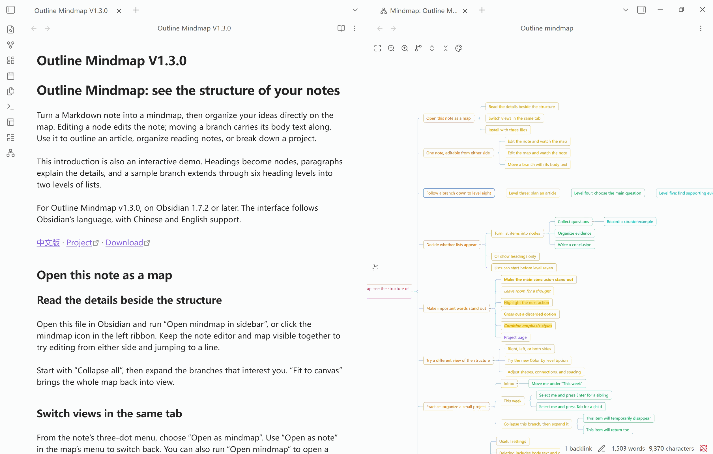

# 大纲思维导图（outline-mindmap）

[English](README.md) · **中文** · [插件介绍（可在 Obsidian 里直接打开的演示笔记）](插件介绍.md)

把 Markdown 笔记的标题大纲变成思维导图，支持双向实时编辑、点击定位和样式自定义。笔记是唯一的数据源，设置保存在插件自己的 `data.json` 中，不添加 frontmatter、标签或隐藏标记。



演示素材录制于旧版本。布局方向现位于「导图 → 外观」。

- 适用于 **Obsidian** 1.7.2 以上 · 桌面端与移动端 · 当前版本 **v1.3.5**
- 界面语言跟随 Obsidian：中文 / English 自动切换，无需任何设置

## 特色功能

- **双向编辑**：支持节点新增、改名、删除和拖拽重排，正文随所属标题移动；写回仅替换相关行范围，保留范围外的内容与格式。
- **浏览与定位**：点击节点定位可见笔记，支持阅读模式；搜索结果可定位并高亮，纯导图也能撤销／重做。
- **笔记与导图互转**：在同一标签页切换，并可记住每篇笔记的打开方式。
- **按需展示**：默认只显示标题，可开启列表节点；支持行内格式、链接文字和公式。
- **样式与布局**：自定义形状、配色、字号、间距、连线及布局方向，支持全局／单篇设置、实时预览和取消还原。
- **便捷操作**：快捷键、平滑动画、按笔记锁定、缩放与位置记忆，以及触屏双指缩放和平移。

一次导图操作对应一步撤销。笔记编辑器使用原生历史；纯导图使用有容量上限的会话历史，检测到外部修改时拒绝覆盖。

## 安装

Obsidian 社区插件市场尚未收录，先手动安装：

1. 到 [Releases](../../releases/latest) 页面下载 `main.js`、`manifest.json`、`styles.css`
   三个文件——插件的全部就是这三个。
2. 把它们放进 `<你的仓库>/.obsidian/plugins/outline-mindmap/`
3. 在「设置 → 第三方插件」里启用「Outline Mindmap」

`main.js` 是构建产物，**没有**提交进仓库，所以克隆源码并不能直接当安装包用——
要么自己构建，要么下 Release。

从源码构建：

```bash
npm ci
npm run build     # 类型检查 + 打包出 main.js
```

## 使用

打开导图有四种方式：

- 左侧栏的导图图标 → 在**右侧边栏**打开
- 命令面板「打开导图」→ 在**主页面区**新标签页打开
- 命令面板「在侧边栏打开导图」
- 笔记右上角三个点 →**「打开为导图」**：当前这个标签页就地变成导图
  （文件列表里右键笔记也有这一项）

导图菜单中的「打开为笔记」可在同一标签页切回笔记，恢复原来的阅读／编辑模式。

- **独立导图视图**：用「打开导图」在标签页显示，或用「在侧边栏打开导图」。两处的跟随行为分别设置。
- **单篇导图**：「打开为导图」将笔记标签页就地转换，只显示该篇笔记。可记住打开方式，形态切换不进入标签页历史。

纯导图中单击节点只会选中，不会另开笔记。需要同时阅读正文时，请在侧边栏或分栏中打开导图；点击定位仅作用于已经可见的笔记。

### 笔记怎么变成导图

| 笔记里的写法 | 导图里的层级 |
| --- | --- |
| `# 标题` … `###### 标题` | 第 1–6 层 |
| `- 列表项`（一层缩进 = 4 个空格或一个 Tab） | 第 7 层起（可用「把列表项显示为节点」关掉） |
| 标题下面的正文段落 | 不显示，但**跟着标题一起移动** |
| 代码块里的 `#` | 不是标题，不会出现在导图里 |

节点文字里的 `**粗体**`、`*斜体*`、`***粗斜***`、`==高亮==`、`~~删除线~~` 会照着渲染，
可以任意嵌套；没配对的 `*`（比如 `2 * 3`）当普通文字，不会被吃掉。

节点中的 `$...$` 行内公式会交给 Obsidian 自带的 MathJax 渲染，可以与普通文字和
其他行内格式混排；公式有误时会退回可编辑的源码，不会拖垮整张导图。
`$$...$$` 块公式仍属于笔记正文，不会被当成节点内的行内公式。

链接只显示**可读的那部分**，路径和 URL 不占节点宽度：

| 笔记里的写法 | 导图里显示 |
| --- | --- |
| `[[某笔记]]` | 某笔记 |
| `[[文件夹/目标\|别名]]` | 别名 |
| `[[笔记#小节]]`、`[[#小节]]` | 小节 |
| `[文字](https://…)` | 文字 |

链接文字会用主题的链接色标出来，但**不可点击**——导图里的单击已经用于跳到笔记对应行，
再抢一次点击只会让人猜不准点下去会发生什么。

### 快捷键

| 按键 | 作用 |
| --- | --- |
| `↑` `↓` | 上一个 / 下一个节点：先找同级兄弟，没有了就退到外层 |
| `→`（「进入」方向） | 分支收着就展开它，已经展开就进到第一个子节点 |
| `←`（「返回」方向） | 分支展开着就收起它，已经收起（或没有子节点）就回到父节点 |
| `Enter` | 在当前节点后面新增一个兄弟节点 |
| `Tab` | 给当前节点新增一个子节点 |
| `F2` / 双击节点 | 重命名 |
| `Delete` / `Backspace` | 删掉选中的节点及其整棵子树 |
| `Ctrl/⌘ + Z` | 撤销（仅打开导图也可使用） |
| `Ctrl/⌘ + Shift + Z` / `Ctrl + Y` | 重做 |
| `Esc` | 放弃当前编辑或当前拖拽，笔记一个字都不写 |
| 双击空白处 | 新建一个自由根节点 |
| `Ctrl/⌘ + 左键` | 加选 / 减选（用于一次删掉一批） |
| 拖拽节点 | 重排：拖到节点上下缘 = 插到前 / 后，拖到中间 = 成为它的子节点，拖到空白 = 变成新的根 |
| 滚轮 | 平移；按住 `Ctrl/⌘` 滚 = 以鼠标为中心缩放 |

方向键的左右是**按节点自己朝哪边生长**来解释的：分支向左时，`←` 才是「进到子节点里去」。

### 工具栏

适应画布 · 缩小 · 放大 · 展开全部 · 折叠全部 · 锁定 · 导图。

**布局方向**（向右 / 向左 / 两侧）位于「导图 → 外观」，支持全局、单篇保存、实时预览和取消还原。

**锁定状态按笔记记忆**。锁定后，仍可平移、缩放、展开折叠、点击定位和调整样式；
笔记端的修改仍实时显示，但不能从导图新增、改名、删除、拖动节点或撤销／重做。
**阅读模式强制锁定**，返回编辑模式后恢复原来的手动锁定状态。
同篇笔记同时打开多个视图时，可见的阅读视图优先；从阅读视图转换成纯导图也会继承阅读模式，
可通过「打开为笔记」返回笔记并切换模式。

**每篇笔记记忆缩放比例与浏览位置**，重启后也能恢复。画布大小改变时，之前浏览的坐标仍位于中央。
如果笔记变化后旧位置已看不到节点，会保留缩放比例并移到附近的节点。
展开／折叠状态仍不持久化，因此布局变化后不能保证同一个节点仍在原位置。

触屏支持**双指缩放与平移**。第二根手指落下会取消尚未完成的节点拖动，手势结束不会顺带点击或编辑节点。
锁定状态下，单指可以从节点或空白处平移；轻点仍可选中和定位。

「分支两侧」会把根节点的子分支**按子树规模**均衡分到左右两列。

## 设置

| 开关 | 默认 | 说明 |
| --- | --- | --- |
| 单击即跳转 | 开 | 单击节点时，把屏幕上的笔记在编辑模式或阅读模式中滚到对应标题或列表项并高亮（焦点始终留在导图上）；在导图里新建 / 重命名 / 删除 / 拖拽之后，笔记也停在那个节点处。**只滚屏幕上已经露着的笔记**——不新开标签页、不分栏、不把后台标签切到前台。关掉后单击只选中 |
| 标签页中的导图 | 固定当前笔记 | 可跟随、固定当前笔记，或为每篇笔记打开独立导图 |
| 侧边栏中的导图 | 跟随当前笔记 | 可跟随或固定当前笔记 |
| 优雅动画 | 开 | 节点与连线同步过渡；超过 250 个可见节点或系统要求减少动态效果时关闭动画 |
| 标题间留空行 | 关 | 新增 / 移动节点时，相邻两个标题之间补足 3 个空行 |
| 显示有序／无序列表节点 | 关 | 分别控制两类列表项是否显示为节点 |
| 深层节点格式 | 无序列表 | 选择第 7 层及以下新写入节点的列表格式 |
| 记住每篇笔记的打开方式 | 开 | 用「打开为导图」转换过的笔记，下次在任何标签页里打开都直接显示为导图；「打开为笔记」即恢复，并还原转换时的阅读 / 编辑模式。记录只存在插件的 `data.json` 里，改名 / 移动 / 删除笔记时自动迁移或清理。形态切换不进入标签页历史，「后退」「前进」只在笔记之间移动 |

样式（形状、配色、**按层级着色**、字号、横纵间距、分支样式：**直线 / 斜线 / 折线**）
分**全局**与**单篇**两级：
单篇没设就用全局的。样式窗口开着时拖滑块会实时预览，取消即还原。
单篇样式的键是文件路径，重命名 / 移动 / 删除笔记时会自动迁移或清理。

## 性能

平移与缩放只更新容器变换，连线合并绘制，节点事件统一委托。超过 250 个可见节点或系统要求减少动态效果时，自动关闭动画。

仓库附带 [1000 节点压力测试笔记](bench/1000节点压力测试笔记.md)。自动化测试覆盖解析、布局与编辑；真实渲染耗时可在 Obsidian 中通过「性能自检」查看。「跟随自检」用于排查导图未跟随活动笔记的问题。

## 已知限制

- 只做**纯文字**导图：不做概要、自由连线、图片、备注。
- 折叠状态不持久化，切换笔记即重置。
- 任务列表 `- [ ]` 按普通文本处理；有序列表读得进来，写回时统一转成 `-`。
- 多选（`Ctrl/⌘ + 左键`）只用于批量删除，不支持批量拖拽移动。

## 开发

```bash
npm run dev        # 监听构建
npm run typecheck  # 严格模式类型检查
npm test           # 单元测试 + 集成测试
```

`core/` 与 `layout/` 保持为不依赖 Obsidian 的纯逻辑；`doc/` 负责文档读写与笔记视图集成，`view/` 负责导图交互，`settings/` 管理设置、样式与偏好。

开发时不必每轮手动复制三个文件，头一次指定仓库，之后一条命令：

```bash
npm run deploy "D:\某个仓库"   # 记住这个目标（写进 deploy.json，不进版本库）
npm run deploy                 # 之后：构建 + 装进记住的仓库
```

它只覆盖 `main.js`、`manifest.json`、`styles.css`，不碰 `data.json`，更不碰笔记。
仓库里若已经有一个目录名不叫 `outline-mindmap` 的同款插件，它会复用那个目录，
不会另建一份 id 相同的出来。

发布前运行 `npm test` 和 `npm run build`，统一 `manifest.json`、`package.json`、
`package-lock.json` 与 `versions.json` 的版本，然后将 `main.js`、`manifest.json`、
`styles.css` 作为附件上传到 `1.3.5` 的 GitHub Release。
**tag 不要带 `v` 前缀**——Obsidian 按纯版本号找 release。

## 更新说明

### v1.3.5

- **打开导图**：标签页可跟随当前笔记、固定当前笔记，或为每篇笔记打开独立导图。侧边栏可单独设置。
- **节点格式**：修复行内代码显示，支持 HTML 内联文字颜色、背景色、上标和下标。
- **列表节点**：独立控制有序与无序列表的显示，从节点菜单新增列表项，并设置深层节点的写入格式。
- **导图外观**：自定义画布、连接线和层级颜色。支持实时预览、恢复默认，以及仅应用到此笔记或所有笔记。
- **文件导出**：直接导出 PNG、SVG 或 PDF，可设置分支范围、背景、留白、画质和 PDF 页面。

### v1.3.4

- **导图锁定**：按笔记记忆手动锁定；阅读模式强制锁定。锁定时禁止导图编辑，笔记修改仍实时显示。
- **布局设置**：布局方向移入「样式设置」，支持全局／单篇保存、实时预览和取消还原。
- **视野记忆**：每篇笔记记住缩放比例与位置，重开时恢复；旧区域为空时显示附近节点。
- **触屏优化**：支持双指缩放与平移，减少拖动冲突和误点击，扩大工具栏与折叠按钮的点击区域。

### v1.3.3

- 增加纯导图撤销／重做、搜索结果定位与高亮；优化层级配色和节点／连线动画。
- 调整默认样式与选项，保留已有设置和单篇样式。

### v1.3.2

- 记住每篇笔记的打开方式，区分跟随型与固定笔记导图；修复切换笔记后显示旧内容的问题。
- 优化就地转换与标签页历史，避免重复打开标签页。

### v1.3.1

- 改进阅读模式点击定位，支持节点行内公式。

### v1.3.0

- 增加中英文界面、列表节点开关和按层级着色。

更早版本见 [Releases](../../releases)。

## 许可证

MIT，见 [LICENSE](LICENSE)。
